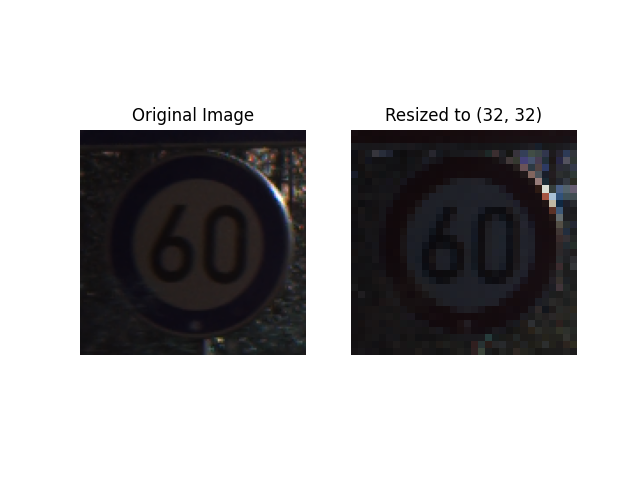
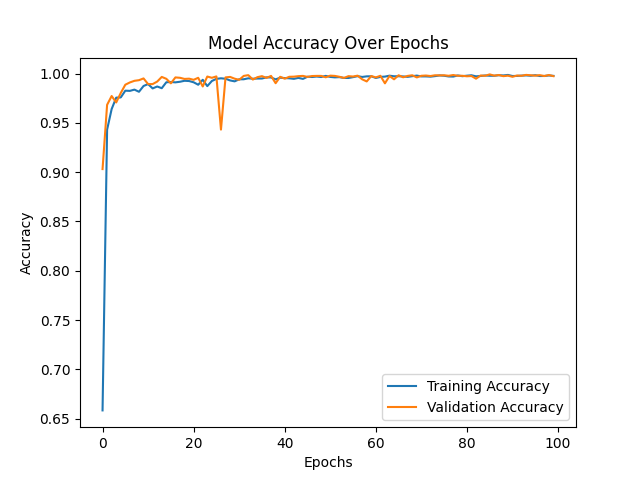
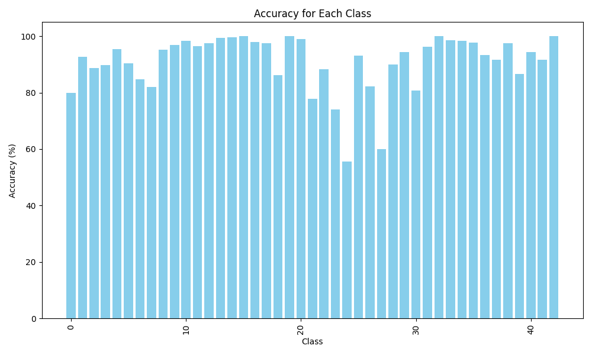
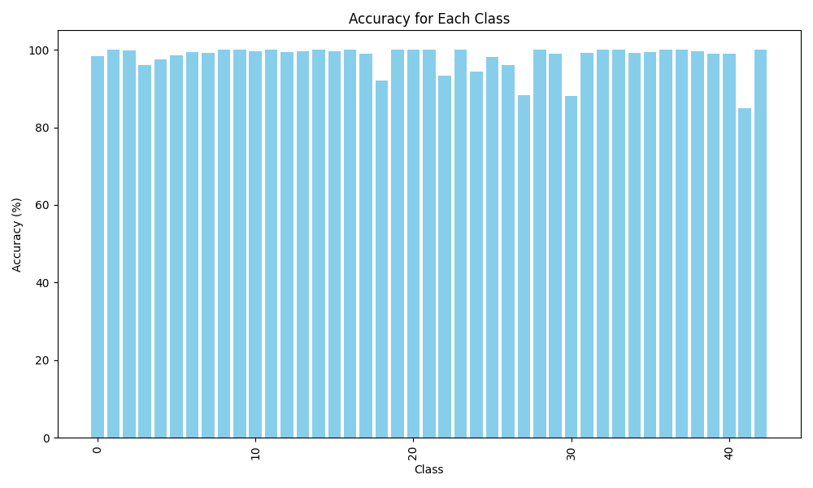

# Road Sign Classifier (GTSRB) — CNN in TensorFlow/Keras

A convolutional neural network that classifies German traffic signs into 43 classes, trained and evaluated on the [GTSRB (German Traffic Sign Recognition Benchmark)](https://www.kaggle.com/datasets/meowmeowmeowmeowmeow/gtsrb-german-traffic-sign) dataset. Built for COMP3419 (The University of Sydney, 2024 S2).

**Result: ~98% accuracy on the 12,629-image test set** (project goal was ≥ 95%).



## Overview

| | |
|---|---|
| **Task** | Multi-class image classification (43 road sign classes) |
| **Dataset** | GTSRB: 39,209 training/validation images, 12,630 test images |
| **Framework** | Python, TensorFlow/Keras, OpenCV, NumPy, Pandas, scikit-learn, Matplotlib |
| **Input** | 32×32 RGB images, pixel values scaled to [0, 1] |
| **Split** | 80/20 train/validation from the training set; separate held-out test set |
| **Training** | 100 epochs, Adam (lr = 1e-3), batch size 64, sparse categorical cross-entropy |

## Model architecture

```
Conv2D(64, 3x3, ReLU)  -> BatchNorm -> MaxPool(2x2)
Conv2D(128, 3x3, ReLU) -> BatchNorm -> MaxPool(2x2)
Conv2D(256, 3x3, ReLU) -> BatchNorm -> MaxPool(2x2)
Dropout(0.5) -> Flatten -> Dense(512, ReLU) -> Dropout(0.5) -> Dense(43, softmax)
```

## Results

I went through two model iterations:

| Model | Architecture | Test accuracy | Training time (100 epochs) |
|---|---|---|---|
| Baseline | 1 conv layer (16 filters), 1 dense layer (64 units) | ~93% | ~1.7 min |
| **Final** | 3 conv blocks with batch norm, 512-unit dense layer | **~98%** | ~4 min (GPU) |



### Key finding: improving the weakest classes

Both models struggled with classes 24 and 27 (~60% accuracy for the baseline). Inspecting the misclassified images showed low colour contrast and very small source resolutions (some under 32×32 before resizing). The deeper network with batch normalisation and heavier dropout raised those classes from **~60% to ~90%**, which matters more for real-world robustness than squeezing extra points out of classes the model already handled well.

| Baseline per-class accuracy | Final per-class accuracy |
|---|---|
|  |  |


## Repository structure

```
.
├── model.py                      # Data loading, preprocessing, training, evaluation, plotting
├── road_sign_model.keras         # Trained model (final architecture)
├── COMP3419-A2-Opt3-Evaluation/
│   ├── evaluation.py             # Per-class and overall accuracy evaluation (rewritten for Keras)
│   ├── test.py                   # Loads a saved .keras model and evaluates it
│   ├── testloader.py             # Test set loader (rewritten for Keras)
│   ├── GTSRB_Test_GT.csv         # Test set ground-truth labels (provided by the course)
│   └── class_accuracy*.png       # Per-class accuracy charts
├── model_accuracy*.png           # Training/validation accuracy curves
├── before_after.png              # Preprocessing example
└── COMP3419_A2_Report.pdf        # Full written report
```

## Setup and usage

### 1. Install dependencies

```bash
pip install tensorflow opencv-python numpy pandas scikit-learn matplotlib tqdm pillow
```

The model runs on CPU but trains much faster on a GPU. I developed on Windows using WSL2 with Miniconda and installed GPU support via `pip install tensorflow[and-cuda]`.

### 2. Download the dataset

The GTSRB images are not included in this repo. Download them from the [kaggle GTSRB page](https://www.kaggle.com/datasets/meowmeowmeowmeowmeow/gtsrb-german-traffic-sign) and place them in the project root, renamed to:

```
GTSRB Train/GTSRB/Final_Training/Images/
GTSRB Test/Final_Test/Images/
```

### 3. Train and evaluate

```bash
python model.py
```

This loads and preprocesses the data, trains the model for 100 epochs, prints test accuracy, saves `road_sign_model.keras`, and writes `model_accuracy.png`.

To evaluate a saved model with the per-class breakdown:

```bash
cd COMP3419-A2-Opt3-Evaluation
python test.py
```

`test.py` loads `../road_sign_model_old.keras` by default. Change that path to `../road_sign_model.keras` to evaluate the final model.

## Implementation notes

- **Data loading:** each class lives in a folder named by its class ID, so labels come directly from folder names.
- **Preprocessing:** images are converted BGR → RGB, scaled to [0, 1], and resized to 32×32 for consistent input and faster training.
- **Evaluation tooling:** the course-provided scaffold targeted PyTorch, so I rewrote `evaluation.py`, `test.py` and `testloader.py` to work with Keras models.

## Dataset credit

J. Stallkamp, M. Schlipsing, J. Salmen, C. Igel. *The German Traffic Sign Recognition Benchmark: A multi-class classification competition.* IJCNN 2011.
